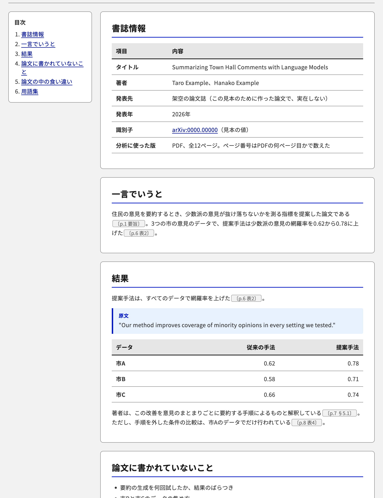

# paper-analysis

論文1本を、本文に書かれた事実だけを根拠に深く読み解き、日本語のレポート（HTML）にまとめるClaude Codeのスキルです。

- 入力：PDFのファイル、arXivのURLやID、DOI
- 出力：デジタル庁デザインシステム（DADS）に沿ったHTMLのレポート（Artifactとして公開できる環境では公開する）
- すべての記述に根拠の場所（PDFのページ、節、図表）を付け、原文の引用は本文と機械で照合する
- 分析者の評価や、読み手の研究への示唆は書かない。論文に書かれていないことは「記載がない」と書く
- 日本語は[docs-rules](https://github.com/knk1313/docs-rules)で校正する。トークンを使いすぎないよう、既定では機械の採点と1回の書き直しだけを行う

論文を読む前に中身を正確に押さえたい人、輪読やゼミの準備をする人に向けたスキルです。



画像は、架空の論文で作った見本（[docs/sample-report.md](docs/sample-report.md)）を表示したものです。

## 入れ方

### Claude Code

```text
/plugin marketplace add knk1313/paper-analysis
/plugin install paper-analysis@paper-analysis
```

日本語の校正も行うときは、docs-rulesも入れてください。

```text
/plugin marketplace add knk1313/docs-rules
/plugin install docs-rules@docs-rules
```

### claude.aiなどのアプリ

[Releases](https://github.com/knk1313/paper-analysis/releases)から`paper-analysis-vX.Y.Z.zip`を取得し、アプリのスキルの設定でアップロードします。新しい版を使うときは、新しい版のzipをアップロードし直します。zipは、リリースを公開したときにGitHub Actionsが作ります。

日本語の校正も行うときは、[docs-rulesのReleases](https://github.com/knk1313/docs-rules/releases)のzipも同じようにアップロードします。アプリでは、次の点がClaude Codeと違います。

- AIによる評価の費用の上限を強制できないため、読むルールのファイルを絞って行います
- 実行環境に`pdftotext`がない場合は、PDFをページごとに読むため、引用の照合の精度が下がります

## 使い方

```text
この論文を分析して ~/Downloads/paper.pdf
https://arxiv.org/abs/<arXiv ID> を読み解いて
DOI <DOI> の論文の中身を押さえたい
```

スキルが使われないときは、`/paper-analysis`と打って呼び出してください。

AIによる評価を含めて丁寧に校正したいときは「しっかり校正して」と添えてください。費用の上限は既定で0.50ドルで、環境変数`PAPER_ANALYSIS_PROOF_BUDGET_USD`で変えられます。

## 必要なもの

- Python 3.9以上（スクリプトは標準ライブラリーだけで動きます）
- `pdftotext`（poppler）。なくても動きますが、引用の照合の精度が下がります。macOSでは`brew install poppler`
- 校正に使う場合：Node.js 18以上とdocs-rules

## 構成

| パス | 内容 |
| --- | --- |
| `skills/paper-analysis/SKILL.md` | 手順の本体 |
| `skills/paper-analysis/references/` | レポートの構成、論文の手に入れ方、校正の上限、デザイン |
| `skills/paper-analysis/scripts/check_quotes.py` | 原文の引用を本文と照合する |
| `skills/paper-analysis/scripts/proof.py` | docs-rulesの採点を、出力を絞って実行する |
| `skills/paper-analysis/scripts/render_html.py` | 原稿のMarkdownをHTMLにする |
| `skills/paper-analysis/assets/template.html` | HTMLのテンプレート（DADSのトークン） |
| `tests/` | スクリプトのテスト。入力は架空の論文 |
| `docs/` | READMEの画像と、その元にした見本の原稿 |
| `ci/plugin-validate/` | CIでプラグインの設定を検証するときに使うClaude Codeの版 |

## 開発

```bash
python3 -m unittest discover -s tests
```

変更の出し方は[CONTRIBUTING.md](CONTRIBUTING.md)、脆弱性の報告は[SECURITY.md](SECURITY.md)を見てください。

## ライセンス

[MIT](LICENSE)。レポートに引用される論文の本文の権利は、それぞれの著者と出版社にあります。
